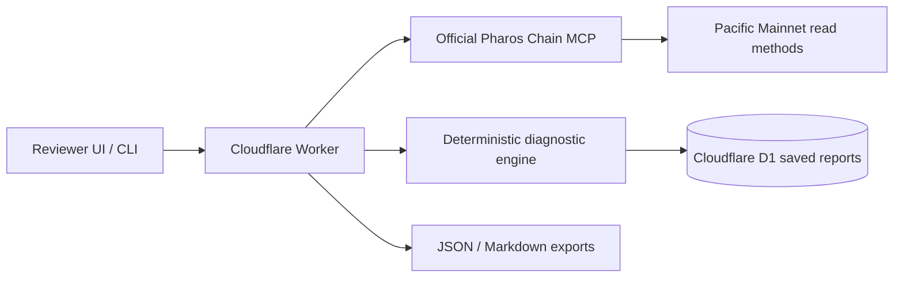

# Pharos dApp Support Agent

A read-only support desk for Pharos Pacific Mainnet transactions. Enter any transaction hash to retrieve the transaction and receipt through the official Pharos Chain MCP, receive a deterministic evidence-bound explanation, save it in D1, and export JSON or Markdown.

## Safety

The application never requests a wallet, private key, signature, approval, unsigned transaction, or broadcast. It performs read-only MCP calls only.

## Evidence model

- Receipt status is authoritative for EVM success/failure.
- `eth_call` at block N and N-1 is supplementary historical replay. It is **not** the exact intra-block prestate of the original transaction.
- Error strings and Solidity panic data are decoded locally. Unknown custom selectors remain UNKNOWN unless an explicitly trusted ABI is supplied.
- RPC/transport errors are never called EVM reverts.
- The official MCP exposes no trace or state-diff tool, so internal call attribution remains unavailable.

## Architecture



## Local commands

```sh
npm install
npm test
npm run build
npm run dev
node src/cli.js 0xTRANSACTION_HASH
```

Create D1, replace `REPLACE_WITH_D1_ID` in `wrangler.jsonc`, apply `migrations/0001_initial.sql`, then deploy. See `scripts/resume-publish-deploy.ps1` for the resumable production sequence.

## Real demonstrations

The UI provides three recorded real failure categories: slippage protection, zero input-token balance, and an application invariant. Versioned evidence records retain the exact MCP observations and disclosed replay limitations.